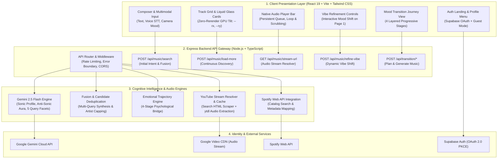
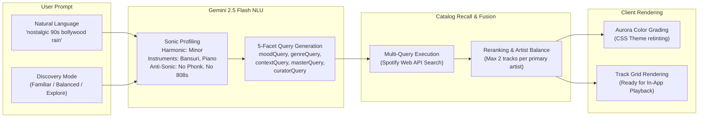
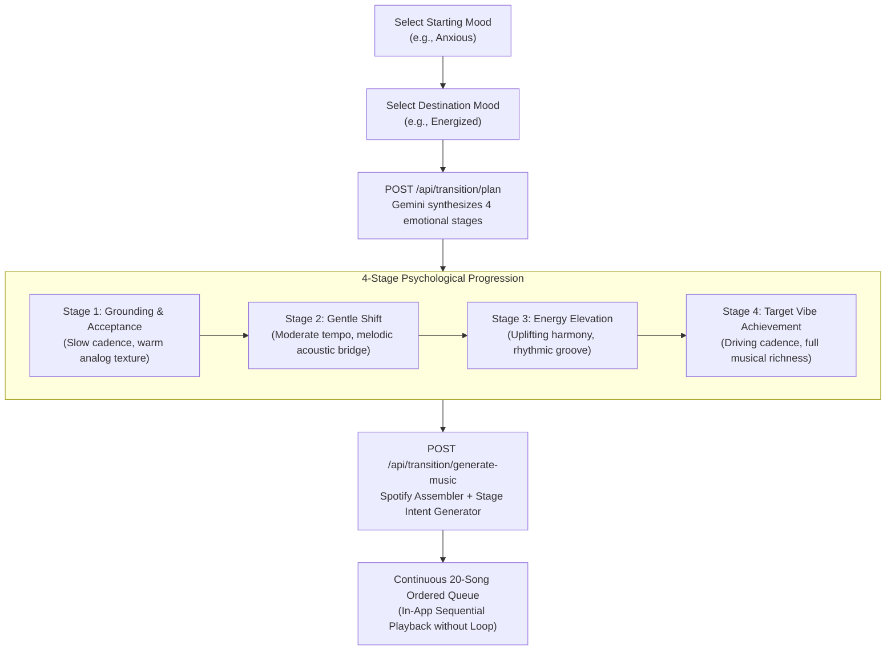

# ECHORA

<div align="center">


**AI-Native Mood & Psychophysiological Music Intelligence Engine**

[](https://react.dev/)
[](https://www.typescriptlang.org/)
[](https://vitejs.dev/)
[](https://tailwindcss.com/)
[](https://nodejs.org/)
[](https://aistudio.google.com/)
[](https://developer.spotify.com/)
[](https://supabase.com/)

</div>

---

## 📖 Overview

**ECHORA** is an intelligent, mood-aware music discovery ecosystem that bridges nuanced human emotion with global music catalogs. Users express how they feel through open-ended natural language (*"quiet rainy midnight in a neon Tokyo café"*), voice dictation, or facial expressions.

ECHORA processes the psychological nuance through **Google Gemini 2.5 Flash**, builds deep sonic profiles (cadence, timbre, harmonic modes, and anti-sonic exclusions), resolves tracks through the **Spotify Web API**, and streams full-length audio in-app with zero subscription requirements.

---

## 🚀 Core Features

- **Multimodal Emotional Input:** Express vibe via natural language text, live browser speech-to-text (Web Speech API), or opt-in facial emotion recognition (MediaStream + Canvas).
- **Deep Sonic Profiling & NLU:** Gemini analyzes psychological nuance to deduce tempo (BPM cadence), timbre textures (e.g. *warm tape saturation*, *cold post-punk reverb*), harmonic mode (*minor*, *major*, *modal*), and **Anti-Sonic Aura** (strict banning of disruptive instruments like phonk cowbells or aggressive trap 808s).
- **Multi-Query Semantic Retrieval:** Generates 5 specialized query facets per intent (`moodQuery`, `genreQuery`, `contextQuery`, `masterQuery`, `curatorQuery`) with cultural anchoring (e.g. Bollywood/Hindi, Spanish, Russian, Japanese) and vintage slang translation.
- **Native In-App Audio Playback:** Full-featured bottom player bar (`BottomPlayerBar`) with real-time scrubbing, buffering feedback, loop modes, and continuous track auto-advancement.
- **Continuous Discovery Engine:** Infinite exploration via `/api/music/load-more` with dynamic track deduplication, artist frequency re-balancing, and interactive `<VibeRefinementBar />` controls.
- **4-Stage Mood Transition Planner:** Synthesizes psychophysiological bridges between disparate emotional states (e.g., *Anxious* → *Grounded* → *Calm* → *Energized*), producing 20 curated tracks with seamless cross-stage queue progression.
- **GPU-Composited 60fps Liquid Glass UI:** Built with React 19, Framer Motion, and Tailwind CSS. Employs `requestAnimationFrame` + CSS custom variable card tilt (`--rx`, `--ry`) with zero React state re-renders during pointer interactions.
- **Identity & Personalization:** Supabase OAuth (Google & Spotify) + instantaneous Guest Mode, persistent favorites, and customizable discovery modes (`Familiar`, `Balanced`, `Explore`).

---

## 🏛️ System Architecture

ECHORA is engineered as a clean 4-tier decoupled pipeline separating client-side presentation, cloud orchestration, intelligence synthesis, and persistent identity.



---

## 🔄 End-to-End Workflows

### 1. Intent Extraction & Continuous Discovery Flow



---

### 2. Native Audio Playback & Streaming Architecture

```mermaid
sequenceDiagram
  autonumber
  actor User
  participant UI as TrackCard / PlayerBar
  participant Backend as Express API (/api/music/stream-url)
  participant Cache as Memory Cache (Map, 3h TTL)
  participant YT as YouTube Engine (ytdl-core)
  participant Audio as HTML5 Audio Element

  User->>UI: Clicks "Play Here" on Track
  UI->>Backend: GET /api/music/stream-url?trackName=...&artist=...
  
  alt Video ID & Stream URL Cached
    Backend->>Cache: Check videoId in memory
    Cache-->>Backend: Return cached audio URL
  else Fresh Extraction
    Backend->>YT: Search & resolve candidate videoId
    Backend->>YT: Extract highest-quality audio format URL
    Backend->>Cache: Save URL (TTL: 3 hours)
  end

  Backend-->>UI: 200 OK { audioUrl: "https://...googlevideo.com/..." }
  UI->>Audio: audio.src = audioUrl; audio.play()
  Audio-->>User: Seamless full-length music playback
```

---

### 3. 4-Stage Mood Transition Journey



---

## ⚡ UI Performance Architecture

ECHORA places extreme emphasis on high-frame-rate interaction and layout stability:

1. **Zero-Rerender 3D Liquid Tilt:**
   * Instead of storing 3D tilt coordinates in React component state (`useState`), `TrackCard` calculates cursor offset on `requestAnimationFrame` and writes directly to CSS variables (`--rx`, `--ry`).
   * Results in smooth **60fps hardware-accelerated animations** without invalidating virtual DOM nodes.
2. **Component Isolation with `React.memo` & `useCallback`:**
   * Heavy components (`TopBar`, `TrackCard`, `TrackGrid`, `LayeredPlaylistView`) are wrapped in `React.memo`.
   * Event handlers are bound with `useCallback` to ensure that keystrokes in the composer do not cause render cascades across the 25+ rendered cards.
3. **Web Vitals Telemetry:**
   * Built-in `initPerfMetrics()` initializes non-intrusive `PerformanceObserver` instances tracking **First Contentful Paint (FCP)**, **Cumulative Layout Shift (CLS)**, and **Long Tasks**.

---

## 📁 Repository Structure

```text
EchoRa/
├── backend/                       # Node.js + Express API Backend
│   ├── src/
│   │   ├── controllers/           # HTTP route handlers (Music, Transition, Camera)
│   │   ├── routes/                # Express endpoint definitions
│   │   ├── services/
│   │   │   ├── gemini/            # Intent extraction, sonic profiles & system instructions
│   │   │   ├── music/             # Multi-query fusion, audio streaming & YouTube resolvers
│   │   │   ├── spotify/           # Spotify Web API client & OAuth helpers
│   │   │   └── transition/        # Stage trajectory generator & playlist assembler
│   │   ├── types/                 # Shared TypeScript interfaces & schemas
│   │   └── server.ts              # Express server entry point
│   └── tests/                     # 20 test suites (Unit & Supertest Integration)
│
├── frontend/                      # React 19 + TypeScript + Vite Client
│   ├── src/
│   │   ├── api/                   # API clients & network error boundaries
│   │   ├── components/            # UI components (Composer, Hero, TrackCard, BottomPlayerBar...)
│   │   │   ├── auth/              # Supabase Auth Landing & OAuth Dialogs
│   │   │   └── transition/        # Mood Transition interactive visualizer
│   │   ├── context/               # React Contexts (AudioPlayerContext, AuthContext)
│   │   ├── hooks/                 # Custom hooks (useSearch, useMoodTheme, useSpeechRecognition)
│   │   ├── lib/                   # Supabase client, formatting helpers, and themes
│   │   └── App.tsx                # Main application orchestrator & layout
│   └── tests/                     # 12 test suites (Vitest + Testing Library)
│
├── package.json                   # Monorepo workspaces definition
└── README.md                      # Architecture documentation
```

---

## 🛠️ Getting Started

### Prerequisites

- **Node.js** `>= 20.0.0`
- **npm** `>= 9.0.0`

### Installation

Clone the repository and install all dependencies:

```bash
git clone https://github.com/Echo-Ra/EchoRa.git
cd EchoRa
npm install
```

---

### Running in Zero-Config Mock Mode

EchoRa includes a comprehensive mock mode with realistic intent extraction, pre-packaged acoustic profiles, and audio previews requiring **no external credentials**:

```bash
npm run dev
```

* **Frontend:** [http://127.0.0.1:5173/](http://127.0.0.1:5173/)
* **Backend:** [http://127.0.0.1:4000/](http://127.0.0.1:4000/)

---

### Configuring Live Mode (Production)

Create a `.env` file in both `backend/` and `frontend/` folders:

#### `backend/.env`
```ini
PORT=4000
NODE_ENV=development

# Google Gemini
GEMINI_API_KEY=your_gemini_api_key_here

# Spotify Web API
SPOTIFY_CLIENT_ID=your_spotify_client_id_here
SPOTIFY_CLIENT_SECRET=your_spotify_client_secret_here
SPOTIFY_REDIRECT_URI=http://127.0.0.1:4000/api/spotify/callback
```

#### `frontend/.env`
```ini
# Supabase OAuth
VITE_SUPABASE_URL=https://your-project.supabase.co
VITE_SUPABASE_ANON_KEY=your_supabase_anon_key_here
```

Launch the development servers:
```bash
npm run dev
```

---

## 🧪 Testing & Verification

Run the comprehensive test suite across the monorepo:

```bash
# Run all backend and frontend tests
npm test

# Run backend unit and integration tests (20 files, 111 tests)
npm run test:backend

# Run frontend UI and context tests (12 files, 60 tests)
npm run test:frontend

# Run strict TypeScript typechecking
npm run typecheck

# Production build verification
npm run build
```

---

## 📄 License

This project is licensed under the [MIT License](LICENSE).
