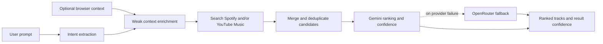

# ECHORA

<div align="center">
  

  <p><strong>Music discovery shaped by how you feel.</strong></p>

  <p>
    Describe a mood, moment, artist, or song. ECHORA interprets the request,
    searches music catalogs, and ranks tracks against your intent.
  </p>
</div>

---

## Contents

- [Overview](#overview)
- [Features](#features)
- [How recommendations work](#how-recommendations-work)
- [Technology](#technology)
- [Requirements](#requirements)
- [Quick start](#quick-start)
- [Configuration](#configuration)
- [Run the app](#run-the-app)
- [Tests and builds](#tests-and-builds)
- [Repository layout](#repository-layout)
- [Privacy and credentials](#privacy-and-credentials)
- [Third-party services](#third-party-services)
- [License](#license)

## Overview

ECHORA is a music discovery application for natural-language requests such as
“peaceful acoustic music for a late-night study session” or “Tum Hi Ho by
Arijit Singh and eight more tracks related to it.” It combines intent
extraction, music catalog search, candidate ranking, and in-app playback.

The app includes a discovery view and a mood-transition view. Users can also
sign in through Supabase OAuth or use a guest session.

## Features

- **Natural-language discovery:** Extracts mood, energy, tempo, artist, title,
  language, genre, and other stated preferences from a prompt.
- **Catalog fallback:** Searches Spotify when configured and can use YouTube
  Music search as a fallback or alternate catalog source.
- **Reference-song recommendations:** Finds a requested song and ranks related
  tracks against its mood and sound. Requested track counts are supported.
- **Track and result confidence:** Shows match scores for tracks and an
  aggregate confidence score for the displayed set.
- **Browser-aware context:** Uses local time and language as optional, weak
  signals. Context does not replace the user's stated intent or infer an
  emotional state.
- **Continuous discovery:** Load more tracks and refine the vibe of a result.
- **Mood transitions:** Builds an ordered music journey between starting and
  destination moods.
- **Playback:** Provides an in-app player and catalog links where available.
- **Discovery modes:** Familiar, Balanced, and Explore modes adjust discovery
  preferences.
- **Authentication:** Supports Google and Spotify sign-in through a configured
  Supabase project, as well as guest sessions.
- **Mock mode:** Lets the frontend run searches with sample data.

## How recommendations work



Gemini is the configured primary AI provider. OpenRouter is used when Gemini
fails, or can serve as the provider when no Gemini key is configured. Spotify
and YouTube Music are catalog sources; OpenRouter is not a music catalog.

For a reference-song request, ECHORA searches for the named track, collects
catalog and AI-suggested candidates, verifies suggestions against a catalog,
then ranks the combined candidates. Catalog availability determines how many
verified tracks can be returned.

## Technology

- React, TypeScript, Vite, and Tailwind CSS frontend
- Node.js, TypeScript, Express, and Zod backend
- Google Gemini with OpenRouter fallback for AI text tasks
- Spotify Web API and the community `ytmusicapi` Python package for catalog
  search
- Supabase Auth for optional OAuth sign-in
- Vitest and Testing Library for automated tests

## Requirements

- Node.js 20 or later
- npm
- Python 3 and pip for YouTube Music search setup
- API credentials for the services you want to use

The frontend and backend can start without live credentials, but live AI
recommendations and catalog search require provider configuration. For YouTube
Music search, install the Python dependency as described below.

## Quick start

```bash
git clone https://github.com/Echo-Ra/EchoRa.git
cd EchoRa
npm install
npm run setup
npm run setup:ytmusic
npm run dev
```

The setup wizard writes backend credentials to the ignored `backend/.env` file.
YouTube Music setup creates a local Python virtual environment under
`backend/.venv` and installs the package listed in `backend/requirements.txt`.

Open the frontend at <http://127.0.0.1:5173>. The backend listens at
<http://127.0.0.1:4000>.

To start without configuring live services, run `npm run dev` and enable **Use
mock data** from the Account menu.

## Configuration

### Backend

Run `npm run setup` from the repository root to configure keys interactively.
You can also copy `backend/.env.example` to `backend/.env` and edit it directly:

```dotenv
GEMINI_API_KEY=
GEMINI_MODEL=gemini-flash-latest
OPENROUTER_API_KEY=
OPENROUTER_MODEL=openai/gpt-4o-mini
SPOTIFY_CLIENT_ID=
SPOTIFY_CLIENT_SECRET=
YT_MUSIC_PYTHON=
```

At least one AI provider key is needed for live AI processing. When both are
configured, Gemini is primary and OpenRouter is the fallback. The default
OpenRouter model is `openai/gpt-4o-mini`.

Spotify credentials are needed to use Spotify search. To enable Spotify
authorization, create an app in the Spotify Developer Dashboard and add this
redirect URI to its settings:

```text
http://127.0.0.1:4000/api/spotify/callback
```

YouTube Music search is an optional catalog fallback. Install it with
`npm run setup:ytmusic`. It uses the unofficial `ytmusicapi` package and does
not require a YouTube Music sign-in for catalog search.

### Frontend authentication

Create `frontend/.env` for Supabase sign-in:

```dotenv
VITE_SUPABASE_URL=https://your-project.supabase.co
VITE_SUPABASE_ANON_KEY=your_supabase_anon_key
```

Configure the desired Google and Spotify OAuth providers and local redirect
URLs in the Supabase project. Guest mode does not require Supabase credentials.

## Run the app

From the repository root:

```bash
npm run dev
```

Run one workspace independently if needed:

```bash
npm run dev:frontend
npm run dev:backend
```

Useful endpoints:

- `GET /api/health` — backend health check
- `GET /api/status` — configured provider and catalog status
- `POST /api/music/search` — search for tracks
- `POST /api/music/load-more` — retrieve another track batch
- `POST /api/music/refine-vibe` — refine a current result
- `POST /api/transition/interpret` — interpret a natural-language transition
- `POST /api/transition/plan` — create a four-stage transition plan
- `POST /api/transition/generate-music` — retrieve tracks for the stages

## Tests and builds

```bash
npm run typecheck
npm test
npm run test:backend
npm run test:frontend
npm run build
```

## Repository layout

```text
backend/
  scripts/       Setup tools, including YouTube Music Python setup
  src/
    controllers/ HTTP handlers
    middleware/  Request validation and error handling
    services/    AI providers, catalog search, recommendations, playback
    types/       Backend interfaces
  tests/         Backend unit and integration tests
frontend/
  src/
    api/         Backend API clients
    components/  Discovery, account, player, and transition UI
    context/     Authentication and player state
    hooks/       Search, status, and transition hooks
    utils/       Browser context and frontend utilities
  tests/         Frontend tests
logos/           ECHORA logo and favicon assets
docs/             Product and implementation notes
```

## Privacy and credentials

- Keep Gemini, OpenRouter, and Spotify secrets in `backend/.env`; never put
  them in frontend code or commit them.
- Frontend Supabase values use the `VITE_` prefix. The anon key is intended for
  client use and must be protected by correct Supabase policies.
- Browser recommendation context is limited to local time, day period,
  timezone, browser language preferences, weekday, and online status. ECHORA
  does not request geolocation or microphone permission for this feature.
- Camera mood analysis and voice dictation are separate, optional features
  that require their respective browser permissions or capabilities.

## Third-party services

ECHORA integrates with Google Gemini, OpenRouter, Spotify, YouTube Music via
`ytmusicapi`, and Supabase. Their APIs, availability, authentication
requirements, and terms are controlled by their respective providers. The
YouTube Music search library is unofficial and may need updates if the service
changes.

## License

No `LICENSE` file is currently included in this repository.
