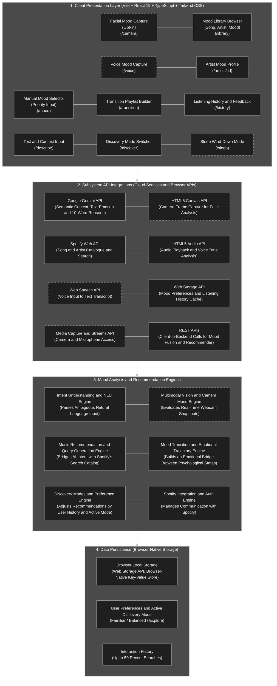
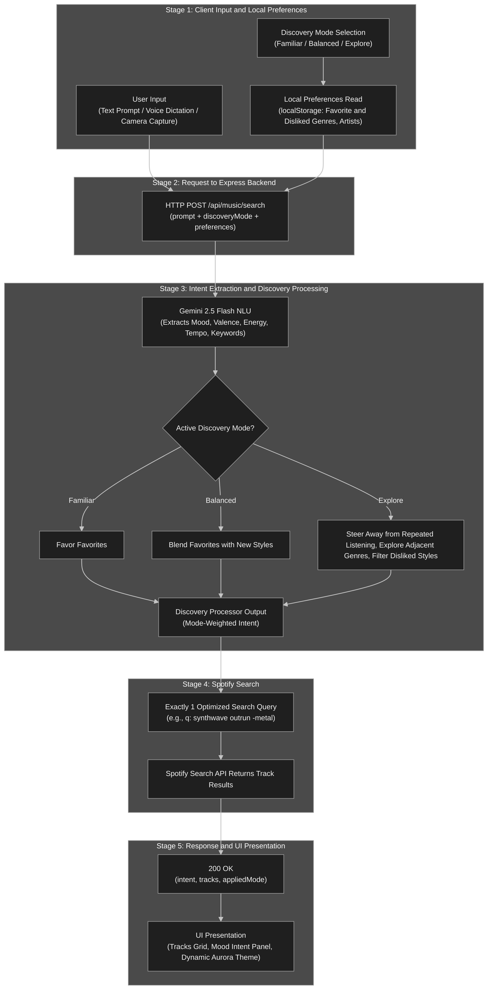
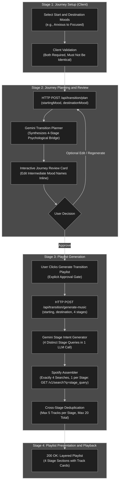

# EchoRa (SONORA) — AI Mood Music Recommender

[](https://react.dev/)
[](https://www.typescriptlang.org/)
[](https://vitejs.dev/)
[](https://tailwindcss.com/)
[](https://nodejs.org/)
[](https://aistudio.google.com/)
[](https://developer.spotify.com/)

**EchoRa (SONORA)** is an intelligent, multimodal music discovery engine that bridges human emotional states with music. Users express their vibe, environment, or state of mind via natural language text, voice dictation, or camera mood capture. The system extracts structured listening intent through **Google Gemini 2.5 Flash** and dynamically orchestrates catalog retrieval via the **Spotify Web API**.

Beyond simple searches, EchoRa features an emotional trajectory engine that plans and generates multi-stage **Mood Transition Journeys** (e.g., transforming an *anxious* state into a *deeply focused* state across a 4-stage psychological bridge).

---

## Table of Contents

- [Core Capabilities](#core-capabilities)
- [System Architecture (Layered)](#system-architecture-layered)
- [Workflow Architecture](#workflow-architecture)
  - [Module 1: Discovery & Mood Search](#module-1-discovery--mood-search)
  - [Module 2: Mood Transition Journey](#module-2-mood-transition-journey)
- [Compliance & Privacy by Design](#compliance--privacy-by-design)
- [Repository Structure](#repository-structure)
- [Getting Started](#getting-started)
  - [Prerequisites](#prerequisites)
  - [Installation](#installation)
  - [Running in Mock Mode (Zero Config)](#running-in-mock-mode-zero-config)
  - [Configuring Live Mode (Gemini + Spotify)](#configuring-live-mode-gemini--spotify)
- [Testing](#testing)

---

## Core Capabilities

- **Multimodal Expression:** Input moods via natural language prompts (*"rainy Tuesday night studying in a quiet coffee shop"*), voice transcription, or camera mood capture.
- **Cognitive Intent Extraction:** Powered by Google Gemini 2.5 Flash NLU to extract valence, energy, tempo, target genres, acoustic qualities, and succinct 10-word explanations.
- **Adaptive Discovery Modes:**
  - `Familiar`: Biases queries toward user favorites and known genres.
  - `Balanced`: Combines favored styles with fresh recommendations.
  - `Explore`: Explores adjacent niches, filtering out repetitive tracks and disliked genres.
- **Mood Transition Journey Planner:** Builds a 4-stage emotional bridge between disparate psychological states (e.g., *Stressed* → *Grounded* → *Calm* → *Energized*), generating tailored soundtrack stages with cross-stage deduplication.
- **Dynamic Aurora UI:** Responsive interface built with React 19, TypeScript, and Tailwind CSS with real-time audio playback previews and contextual mood themes.

---

## System Architecture (Layered)

The platform is designed in four distinct layers ensuring clear separation of concerns, high maintainability, and strict adherence to API policies.



### Layer Breakdown

1. **Client Presentation Layer:** Interactive views providing manual mood selectors, text input, camera/voice captures, mood library browsing, history, and transition builders.
2. **Subsystem API Integrations:** Handles cloud connections (Gemini NLU, Spotify Web API) and native browser APIs (Web Speech, Canvas, HTML5 Audio, Web Storage).
3. **Mood Analysis & Recommendation Engines:**
   - **NLU Engine:** Parses ambiguous natural language queries into structured musical parameters.
   - **Query Generation Engine:** Bridges emotional attributes into Spotify-compatible search parameters.
   - **Preference & Discovery Engine:** Weights queries against user preferences and active modes.
   - **Emotional Trajectory Engine:** Synthesizes psychophysiological transition states.
   - **Spotify Integration Engine:** Handles OAuth 2.0 PKCE / token exchanges and API queries.
4. **Data Persistence:** Browser-native local storage retaining preferences, recent history (up to 50 queries), and favorite/disliked tags without external tracking.

---

## Workflow Architecture

EchoRa operates via staged pipelines featuring deterministic decision gates.

### Module 1: Discovery & Mood Search

Transforms open-ended user input and mode preferences into an optimized Spotify catalog search:



- **Stage 1 (Client Input):** Capture prompt + active mode (`Familiar`, `Balanced`, `Explore`) + stored preferences.
- **Stage 2 (Backend Request):** `POST /api/music/search` sends payload to the Express server.
- **Stage 3 (Intent & Discovery Processing):** Gemini 2.5 Flash extracts musical intent parameters. The discovery processor shapes the query based on the active mode.
- **Stage 4 (Spotify Search):** Exactly 1 optimized query string is executed against the Spotify Search API.
- **Stage 5 (Response & Presentation):** Server delivers intent explanation and matching track metadata; the client updates the UI and aurora theme.

---

### Module 2: Mood Transition Journey

Creates an emotional progression that guides the user from an initial psychological state to a desired target mood:



- **Stage 1 (Journey Setup):** Select and validate starting and destination moods.
- **Stage 2 (Planning & Review):** Gemini synthesizes a 4-step psychological progression. The user can review, customize stage names, or regenerate.
- **Stage 3 (Playlist Generation):** Upon approval, Gemini generates 4 distinct stage queries in a single call. The Spotify assembler executes searches with cross-stage deduplication (up to 5 tracks per stage, max 20 total).
- **Stage 4 (Playback & Presentation):** Renders a multi-stage sequential track progression with audio previews.

---

## Compliance & Privacy by Design

- **Strict One-Way Pipeline:** Gemini interprets *only* user natural-language queries. No Spotify track content, artist catalog data, or user listening histories are ever fed into or stored by AI models.
- **No Scraping or AI Profiling:** Spotify content is queried in real time purely for immediate playback previews, track metadata, and direct attribution links.
- **Client-Side Privacy:** Camera frame capture and voice transcription run locally using browser-native APIs without transmitting raw biometric video or voice feeds to external servers.

---

## Repository Structure

```text
EchoRa/
├── package.json               # Root workspace configuration
├── frontend/                  # React 19 + TypeScript + Vite + Tailwind CSS
│   ├── src/
│   │   ├── api/               # API clients & Mock providers
│   │   ├── components/        # UI components (SearchBar, IntentDisplay, TrackCard, Aurora...)
│   │   └── App.tsx            # Root application layout & state
│   └── tests/                 # Frontend component and integration tests
├── backend/                   # Node.js + Express + TypeScript
│   ├── scripts/setup.ts       # Interactive setup wizard for API credentials
│   ├── src/
│   │   ├── services/
│   │   │   ├── gemini/        # Gemini intent extraction & transition planner
│   │   │   ├── spotify/       # Spotify OAuth 2.0 & catalog search
│   │   │   └── music/         # Query generation & mode filtering pipeline
│   │   ├── routes/            # REST API endpoints
│   │   ├── controllers/       # Controller handlers
│   │   └── app.ts             # Express application initialization
│   └── tests/
│       ├── unit/              # Backend service unit tests
│       └── integration/       # Supertest route tests
└── README.md                  # Project documentation & architecture
```

---

## Getting Started

### Prerequisites

- **Node.js** `>= 20.0.0`
- **npm** `>= 9.0.0`
- *(Optional for Live Mode)* **Google Gemini API Key** and a **Spotify Developer Account**.

### Installation

Clone the repository and install dependencies across the monorepo:

```bash
git clone https://github.com/your-username/EchoRa.git
cd EchoRa
npm install
```

### Running in Mock Mode (Zero Config)

EchoRa provides a full **Mock Mode** with realistic canned intent extraction and tracks, requiring **no API keys** to run:

```bash
npm run dev
```

Navigate to `http://127.0.0.1:5173`. The status bar will show `Mock Mode`.

### Configuring Live Mode (Gemini + Spotify)

1. Obtain a **Gemini API Key** from [Google AI Studio](https://aistudio.google.com/app/apikey).
2. Create an application in the [Spotify Developer Dashboard](https://developer.spotify.com/dashboard):
   - Set Redirect URI to: `http://127.0.0.1:4000/api/spotify/callback`
3. Launch the interactive credential setup wizard:
   ```bash
   npm run setup
   ```
4. Start the application:
   ```bash
   npm run dev
   ```
5. Click **Connect Spotify** in the UI to complete the OAuth 2.0 handshake. The status bar will switch to **Live Mode**.

---

## Testing

Run unit, integration, and type checks across all workspaces:

```bash
# Run all test suites
npm test

# Run backend tests only
npm run test:backend

# Run frontend tests only
npm run test:frontend

# Run TypeScript typechecks
npm run typecheck
```

---

## License

This project is open-source under the [MIT License](LICENSE).
